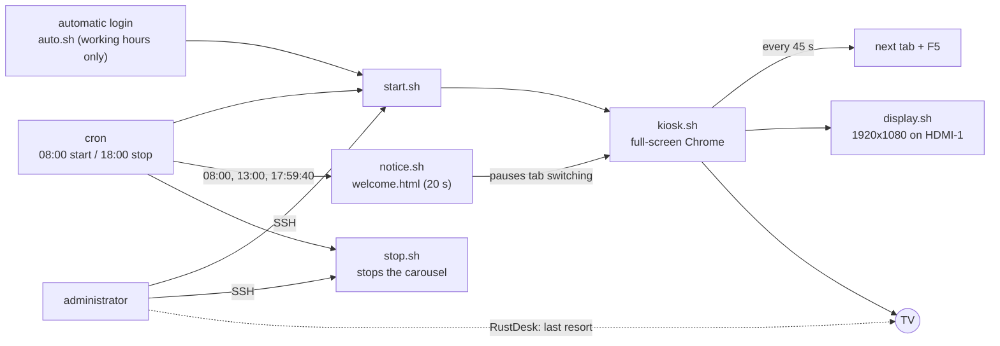

# tv-kiosk-carousel

[Português](README.md) · **English** · [Español (Honduras)](README.es-HN.md)

Turns a repurposed mini PC into a TV kiosk: Chrome opens in full screen, rotates through pages in a carousel, starts and stops on a schedule, shows welcome and goodbye screens, and is administered over SSH without the people watching the TV noticing.

## The problem

Many companies have dashboards (monitoring, tickets, indicators) hidden in browser tabs nobody opens. The obvious fix is a TV on the wall showing those pages, but it needs a computer attached to it, and that computer must:

- start by itself, with no keyboard, no mouse and nobody to click;
- never sleep, lock the screen or show system notices;
- switch pages and reload on its own, so the data never goes stale;
- follow a working-hours schedule;
- be administered remotely without disturbing whoever is looking at the TV.

This project gathers the scripts, configuration files and step-by-step guide that solved this on an idle mini PC running Linux Mint and Chrome.

## How it works (overview)



In short:

- **`kiosk.sh`** opens Chrome in kiosk mode with the pages from `urls.txt` and, every 45 seconds, moves to the next tab and reloads.
- **cron** starts and stops the carousel on schedule (example: Monday to Friday, 08:00 to 18:00) and triggers the welcome and goodbye screens.
- **`auto.sh`** covers the case where the machine reboots: it only opens the carousel when inside working hours.
- **SSH** is the main access: you can edit pages, schedules and settings without interfering with what is on screen. **RustDesk** is the last resort, for when you need to see the real screen.
- The machine never sleeps, never locks the screen, and has the unneeded software removed.

## Repository layout

```
tv-kiosk-carousel/
├── scripts/    kiosk.sh, display.sh, start.sh, stop.sh, auto.sh, notice.sh
├── web/        welcome.html (welcome and goodbye screen)
├── config/     urls.txt.example, kiosk.desktop, crontab.example,
│               logind-99-always-on.conf
└── docs/       pt-BR/, en/, es-HN/
                (installation, remote access, rollback, lessons learned)
```

## Requirements

- A mini PC (or other x86 computer) with an HDMI output, connected by network cable.
- A Full HD (1920x1080) TV.
- Linux Mint 21.3 Xfce (Ubuntu 22.04 base). This is the tested system; other Xfce and X11 distributions should work with adjustments.
- Google Chrome, `xdotool`, `unclutter`, NetworkManager, `cron`, `openssh-server`, `ufw` and RustDesk (optional, for the last resort).
- Access to the router/firewall to reserve a fixed IP (optional, but recommended).

## Deployment, step by step

The full guide is in [docs/en/install-and-tuning.md](docs/en/install-and-tuning.md). In short:

1. Install Linux Mint Xfce, with automatic login of the `kiosk` user and the correct time zone.
2. Fix the IP (DHCP reservation and on Linux).
3. Set up remote access: [docs/en/remote-access.md](docs/en/remote-access.md).
4. Apply the tuning: no suspend, no screen lock, unneeded programs and services disabled.
5. Force HDMI-1 as an always-on output (kernel parameter), so remote access works even with no TV.
6. Install Chrome, `xdotool` and `unclutter`.
7. Enable the firewall, allowing SSH only from the trusted ranges.
8. Copy the scripts to `~/kiosk`, make them executable (`chmod +x ~/kiosk/*.sh`) and create `urls.txt` from `urls.txt.example`.
9. Install `kiosk.desktop` in `~/.config/autostart/` and `crontab.example` in the user's `crontab -e`.
10. Reboot and validate.

## How to validate

Reboot the machine with the TV on HDMI-1, without touching anything. Expected: Chrome opens by itself in full screen, pages switch every 45 seconds and the image is complete and sharp. Quick checks:

```
DISPLAY=:0 xrandr --listmonitors                        # HDMI-1 at 1920x1080
systemctl is-active ssh rustdesk NetworkManager cron    # all "active"
pgrep -fa kiosk.sh                                      # carousel running
sudo ufw status verbose                                 # firewall active
crontab -l                                              # schedule
```

The welcome and goodbye screens can only be validated through cron on the first working day. To test them right away: `~/kiosk/notice.sh welcome` or `~/kiosk/notice.sh goodbye`. Details in section 9 of the installation guide.

## Day-to-day use

- **Start by hand (overtime, weekends):** `~/kiosk/start.sh`
- **Stop:** `~/kiosk/stop.sh`
- **Change the pages:** edit `~/kiosk/urls.txt` and restart the carousel (`stop.sh` and then `start.sh`)
- **Change the schedule:** `crontab -e`

The TV is turned on and off by hand by the team: the mini PC does not control the TV.

## Common problems

| Symptom | What to do |
|---|---|
| Remote access shows "No Displays" | Apply the kernel parameter `video=HDMI-A-1:1920x1080@60e` |
| Image cut at the edges | Set the TV picture format to a no-crop mode (such as "Just Scan") |
| Chrome asks for a keyring password | Leave the password empty and confirm "Use Unsafe Storage" |
| Carousel does not open after a reboot | It rebooted outside working hours: `~/kiosk/start.sh` |
| Alt+F4 or F11 and Chrome comes back | Use `~/kiosk/stop.sh` |

The full table is in the installation guide. To undo any change, see [docs/en/rollback.md](docs/en/rollback.md). What we learned reusing hardware, including the problems with a laptop, is in [docs/en/lessons-learned.md](docs/en/lessons-learned.md).

## Notice: fictional data

All IP addresses, user names, computer names, domains, MAC addresses, company names and logos in this repository are **fictional**. The IPs belong to the ranges reserved for documentation (`192.0.2.0/24`, `198.51.100.0/24` and `203.0.113.0/24`) and the MAC is an example value. Replace everything with the values of your own environment. Never publish your real `urls.txt`: shared pages usually carry access tokens. The `.gitignore` already excludes it.

## Roadmap

Planned improvements and lessons from the project: [ROADMAP.en.md](ROADMAP.en.md).

## Topics

`kiosk` · `kiosk-mode` · `digital-signage` · `tv-display` · `dashboard` · `carousel` · `linux-mint` · `xfce` · `google-chrome` · `bash` · `shell-script` · `xdotool` · `cron` · `ssh` · `rustdesk` · `ufw` · `sysadmin` · `it-infrastructure`

## License

GPL-3.0. See the [LICENSE](LICENSE) file. Copyright (C) 2026 Manuel Pérez.
