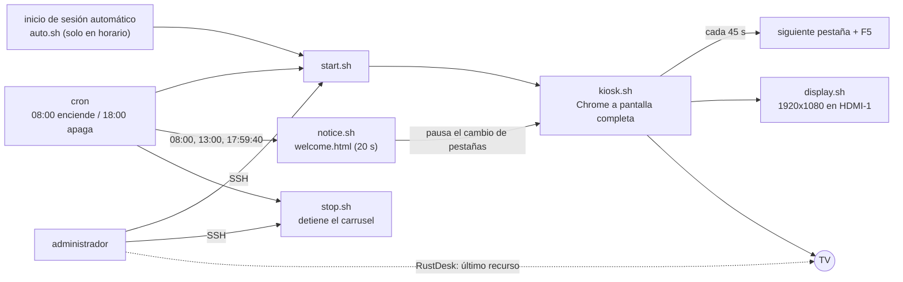

# tv-kiosk-carousel

[Português](README.md) · [English](README.en.md) · **Español (Honduras)**

Convierte un mini PC reutilizado en una TV de quiosco: Chrome abre a pantalla completa, rota entre páginas en un carrusel, enciende y se apaga en un horario acordado, muestra pantallas de bienvenida y despedida, y se administra por SSH sin que quienes miran la TV lo noten.

## El problema

Muchas empresas tienen paneles (monitoreo, tickets, indicadores) escondidos en pestañas que nadie abre. La solución obvia es una TV en la pared que muestre esas páginas, pero requiere una computadora conectada a ella, y esa computadora debe:

- encender sola, sin teclado, sin mouse y sin alguien que haga clic;
- no dormirse nunca, no bloquear la pantalla ni mostrar avisos del sistema;
- cambiar de página y recargar por sí misma, para que los datos no queden viejos;
- respetar un horario de trabajo;
- administrarse a distancia sin molestar a quien está mirando la TV.

Este proyecto reúne los scripts, las configuraciones y la guía paso a paso que resolvieron esto en un mini PC que estaba parado, con Linux Mint y Chrome.

## Cómo funciona (visión general)



En resumen:

- **`kiosk.sh`** abre Chrome en modo quiosco con las páginas de `urls.txt` y, cada 45 segundos, pasa a la siguiente pestaña y recarga.
- **cron** enciende y detiene el carrusel en el horario (ejemplo: lunes a viernes, de 08:00 a 18:00) y dispara las pantallas de bienvenida y despedida.
- **`auto.sh`** cubre el caso de que el equipo se reinicie: solo abre el carrusel si está dentro del horario.
- **SSH** es el acceso principal: permite editar páginas, horarios y configuraciones sin interferir con lo que se ve en pantalla. **RustDesk** queda como último recurso, cuando hace falta ver la pantalla real.
- El equipo nunca se duerme, no bloquea la pantalla y tiene eliminados los programas innecesarios.

## Estructura del repositorio

```
tv-kiosk-carousel/
├── scripts/    kiosk.sh, display.sh, start.sh, stop.sh, auto.sh, notice.sh
├── web/        welcome.html (pantalla de bienvenida y despedida)
├── config/     urls.txt.example, kiosk.desktop, crontab.example,
│               logind-99-always-on.conf
└── docs/       pt-BR/, en/, es-HN/
                (instalación, acceso remoto, revertir, lecciones aprendidas)
```

## Requisitos

- Un mini PC (u otra computadora x86) con salida HDMI, conectado por cable de red.
- Una TV Full HD (1920x1080).
- Linux Mint 21.3 Xfce (base Ubuntu 22.04). Es el sistema probado; otras distribuciones con Xfce y X11 deberían funcionar con ajustes.
- Google Chrome, `xdotool`, `unclutter`, NetworkManager, `cron`, `openssh-server`, `ufw` y RustDesk (opcional, para el último recurso).
- Acceso al router o firewall para reservar una IP fija (opcional, pero recomendado).

## Implementación, paso a paso

La guía completa está en [docs/es-HN/install-and-tuning.md](docs/es-HN/install-and-tuning.md). En resumen:

1. Instale Linux Mint Xfce, con inicio de sesión automático del usuario `kiosk` y la zona horaria correcta.
2. Fije la IP (reserva en el DHCP y en Linux).
3. Configure el acceso remoto: [docs/es-HN/remote-access.md](docs/es-HN/remote-access.md).
4. Aplique la optimización: sin suspensión, sin bloqueo de pantalla, programas y servicios innecesarios desactivados.
5. Fuerce HDMI-1 como salida siempre activa (parámetro del kernel), para que el acceso remoto funcione incluso sin TV.
6. Instale Chrome, `xdotool` y `unclutter`.
7. Active el firewall permitiendo SSH solo desde los rangos de confianza.
8. Copie los scripts a `~/kiosk`, hágalos ejecutables (`chmod +x ~/kiosk/*.sh`) y cree `urls.txt` a partir de `urls.txt.example`.
9. Instale `kiosk.desktop` en `~/.config/autostart/` y `crontab.example` en el `crontab -e` del usuario.
10. Reinicie y valide.

## Cómo validar

Reinicie el equipo con la TV en HDMI-1, sin tocar nada. Lo esperado: Chrome abre solo a pantalla completa, las páginas cambian cada 45 segundos y la imagen aparece completa y nítida. Verificaciones rápidas:

```
DISPLAY=:0 xrandr --listmonitors                        # HDMI-1 en 1920x1080
systemctl is-active ssh rustdesk NetworkManager cron    # todos "active"
pgrep -fa kiosk.sh                                      # carrusel en ejecución
sudo ufw status verbose                                 # firewall activo
crontab -l                                              # programación
```

Las pantallas de bienvenida y despedida solo se pueden validar por el cron el primer día hábil. Para probarlas de inmediato: `~/kiosk/notice.sh welcome` o `~/kiosk/notice.sh goodbye`. Detalles en la sección 9 de la guía de instalación.

## Uso del día a día

- **Encender a mano (horas extra, fin de semana):** `~/kiosk/start.sh`
- **Detener:** `~/kiosk/stop.sh`
- **Cambiar las páginas:** editar `~/kiosk/urls.txt` y reiniciar el carrusel (`stop.sh` y luego `start.sh`)
- **Cambiar el horario:** `crontab -e`

La TV la enciende y la apaga a mano el equipo: el mini PC no controla la TV.

## Problemas comunes

| Síntoma | Qué hacer |
|---|---|
| El acceso remoto muestra "No Displays" | Aplicar el parámetro del kernel `video=HDMI-A-1:1920x1080@60e` |
| Imagen cortada en los bordes | Ajustar el formato de imagen de la TV a un modo sin recorte (como "Just Scan") |
| Chrome pide contraseña de llavero | Dejar la contraseña en blanco y confirmar "Use Unsafe Storage" |
| El carrusel no abre después de reiniciar | Se reinició fuera del horario: `~/kiosk/start.sh` |
| Alt+F4 o F11 y Chrome vuelve solo | Use `~/kiosk/stop.sh` |

La tabla completa está en la guía de instalación. Para deshacer cualquier cambio, vea [docs/es-HN/rollback.md](docs/es-HN/rollback.md). Lo que aprendimos reutilizando equipo, incluidos los problemas con una laptop, está en [docs/es-HN/lessons-learned.md](docs/es-HN/lessons-learned.md).

## Aviso: datos ficticios

Todas las direcciones IP, nombres de usuario, nombres de computadora, dominios, direcciones MAC, nombres de empresa y logotipos de este repositorio son **ficticios**. Las IP pertenecen a los rangos reservados para documentación (`192.0.2.0/24`, `198.51.100.0/24` y `203.0.113.0/24`) y la MAC es un valor de ejemplo. Reemplace todo por los valores de su propio entorno. Nunca publique su `urls.txt` real: las páginas compartidas suelen llevar tokens de acceso. El `.gitignore` ya lo excluye.

## Hoja de ruta

Mejoras previstas y lecciones del proyecto: [ROADMAP.es-HN.md](ROADMAP.es-HN.md).

## Temas

`kiosk` · `kiosk-mode` · `digital-signage` · `tv-display` · `dashboard` · `carousel` · `linux-mint` · `xfce` · `google-chrome` · `bash` · `shell-script` · `xdotool` · `cron` · `ssh` · `rustdesk` · `ufw` · `sysadmin` · `it-infrastructure`

## Licencia

GPL-3.0. Vea el archivo [LICENSE](LICENSE). Copyright (C) 2026 Manuel Pérez.
