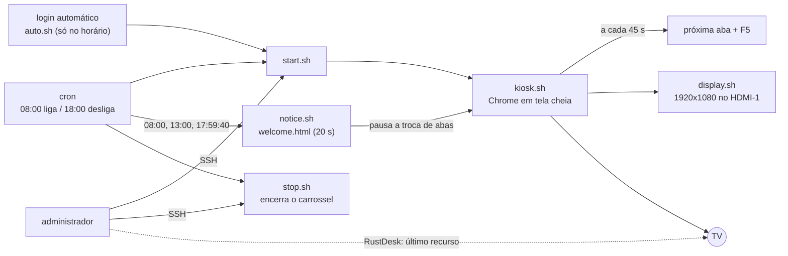

# tv-kiosk-carousel

**Português** · [English](README.en.md) · [Español (Honduras)](README.es-HN.md)

Transforma um mini PC reaproveitado em uma TV de quiosque: o Chrome abre em tela cheia, troca de página em um carrossel, liga e desliga em horário combinado, mostra telas de boas-vindas e despedida, e é administrado por SSH sem que quem olha a TV perceba.

## O problema

Muitas empresas têm dashboards (monitoramento, chamados, indicadores) que ficam escondidos em abas que ninguém abre. A solução óbvia é uma TV na parede mostrando essas páginas, mas ela exige um computador ligado a ela, e esse computador precisa:

- ligar sozinho, sem teclado, mouse nem alguém para clicar;
- nunca dormir, não bloquear a tela nem mostrar avisos do sistema;
- trocar de página e recarregar sozinho, para os dados não ficarem velhos;
- obedecer a um horário de expediente;
- ser administrado à distância sem atrapalhar quem está olhando a TV.

Este projeto reúne os scripts, as configurações e o passo a passo que resolveram isso em um mini PC que estava parado, com Linux Mint e Chrome.

## Como funciona (visão geral)



Em resumo:

- O **`kiosk.sh`** abre o Chrome em modo quiosque com as páginas de `urls.txt` e, a cada 45 segundos, vai para a próxima aba e recarrega.
- O **cron** liga e encerra o carrossel no horário (exemplo: segunda a sexta, das 08:00 às 18:00) e dispara as telas de boas-vindas e despedida.
- O **`auto.sh`** cobre o caso de o equipamento reiniciar: só abre o carrossel se estiver dentro do horário.
- O **SSH** é o acesso principal: dá para editar páginas, horários e configurações sem interferir no que está na tela. O **RustDesk** fica como último recurso, quando é preciso ver a tela de verdade.
- O equipamento nunca dorme, não bloqueia a tela e tem os programas desnecessários removidos.

## Estrutura do repositório

```
tv-kiosk-carousel/
├── scripts/    kiosk.sh, display.sh, start.sh, stop.sh, auto.sh, notice.sh
├── web/        welcome.html (tela de boas-vindas e despedida)
├── config/     urls.txt.example, kiosk.desktop, crontab.example,
│               logind-99-always-on.conf
└── docs/       pt-BR/, en/, es-HN/
                (instalação, acesso remoto, reverter, lições aprendidas)
```

## Pré-requisitos

- Um mini PC (ou outro computador x86) com saída HDMI, ligado por cabo de rede.
- Uma TV Full HD (1920x1080).
- Linux Mint 21.3 Xfce (base Ubuntu 22.04). Foi o sistema testado; outras distribuições com Xfce e X11 devem funcionar com ajustes.
- Google Chrome, `xdotool`, `unclutter`, NetworkManager, `cron`, `openssh-server`, `ufw` e RustDesk (opcional, para o último recurso).
- Acesso ao roteador/firewall para reservar um IP fixo (opcional, mas recomendado).

## Passo a passo de implantação

O guia completo está em [docs/pt-BR/install-and-tuning.md](docs/pt-BR/install-and-tuning.md). Resumindo:

1. Instale o Linux Mint Xfce, com login automático do usuário `kiosk` e fuso horário correto.
2. Fixe o IP (reserva no DHCP e no Linux).
3. Configure o acesso remoto: [docs/pt-BR/remote-access.md](docs/pt-BR/remote-access.md).
4. Aplique as otimizações: sem suspensão, sem bloqueio de tela, programas e serviços desnecessários desativados.
5. Force o HDMI-1 como saída sempre ativa (parâmetro de kernel), para o acesso remoto funcionar mesmo sem TV.
6. Instale o Chrome, `xdotool` e `unclutter`.
7. Ative o firewall liberando o SSH só para as faixas de confiança.
8. Copie os scripts para `~/kiosk`, torne-os executáveis (`chmod +x ~/kiosk/*.sh`) e crie o `urls.txt` a partir do `urls.txt.example`.
9. Instale o `kiosk.desktop` em `~/.config/autostart/` e o `crontab.example` no `crontab -e` do usuário.
10. Reinicie e valide.

## Como validar

Reinicie o equipamento com a TV na HDMI-1, sem tocar em nada. O esperado: o Chrome abre sozinho em tela cheia, as páginas trocam a cada 45 segundos e a imagem aparece completa e nítida. Verificações rápidas:

```
DISPLAY=:0 xrandr --listmonitors                        # HDMI-1 em 1920x1080
systemctl is-active ssh rustdesk NetworkManager cron    # todos "active"
pgrep -fa kiosk.sh                                      # carrossel em execução
sudo ufw status verbose                                 # firewall ativo
crontab -l                                              # agendamento
```

As telas de boas-vindas e despedida só podem ser validadas pelo cron no primeiro dia útil. Para testar na hora: `~/kiosk/notice.sh welcome` ou `~/kiosk/notice.sh goodbye`. Detalhes na seção 9 do guia de instalação.

## Uso no dia a dia

- **Ligar à mão (hora extra, fim de semana):** `~/kiosk/start.sh`
- **Encerrar:** `~/kiosk/stop.sh`
- **Mudar as páginas:** editar `~/kiosk/urls.txt` e reiniciar o carrossel (`stop.sh` e depois `start.sh`)
- **Mudar o horário:** `crontab -e`

A TV é ligada e desligada à mão pela equipe: o mini PC não controla a TV.

## Problemas comuns

| Sintoma | O que fazer |
|---|---|
| Acesso remoto mostra "No Displays" | Aplicar o parâmetro de kernel `video=HDMI-A-1:1920x1080@60e` |
| Imagem cortada nos cantos | Ajustar o formato da imagem na TV (modo sem corte, como "Just Scan") |
| Chrome pede senha de chaveiro | Deixar a senha em branco e confirmar "Use Unsafe Storage" |
| Carrossel não abre depois de reiniciar | Reiniciou fora do horário: `~/kiosk/start.sh` |
| Alt+F4 ou F11 e o Chrome volta sozinho | Use `~/kiosk/stop.sh` |

A tabela completa está no guia de instalação. Para desfazer qualquer mudança, veja [docs/pt-BR/rollback.md](docs/pt-BR/rollback.md). O que aprendemos reaproveitando hardware, inclusive os problemas com um notebook, está em [docs/pt-BR/lessons-learned.md](docs/pt-BR/lessons-learned.md).

## Aviso: dados fictícios

Todos os endereços IP, nomes de usuário, nomes de computador, domínios, endereços MAC, nomes de empresa e logotipos deste repositório são **fictícios**. Os IPs pertencem às faixas reservadas para documentação (`192.0.2.0/24`, `198.51.100.0/24` e `203.0.113.0/24`) e o MAC é um valor de exemplo. Troque tudo pelos valores do seu ambiente. Nunca publique o seu `urls.txt` real: páginas compartilhadas costumam ter tokens de acesso. O `.gitignore` já o exclui.

## Roadmap

Melhorias previstas e aprendizados do projeto: [ROADMAP.md](ROADMAP.md).

## Tópicos

`kiosk` · `kiosk-mode` · `digital-signage` · `tv-display` · `dashboard` · `carousel` · `linux-mint` · `xfce` · `google-chrome` · `bash` · `shell-script` · `xdotool` · `cron` · `ssh` · `rustdesk` · `ufw` · `sysadmin` · `it-infrastructure`

## Licença

GPL-3.0. Veja o arquivo [LICENSE](LICENSE). Copyright (C) 2026 Manuel Pérez.
